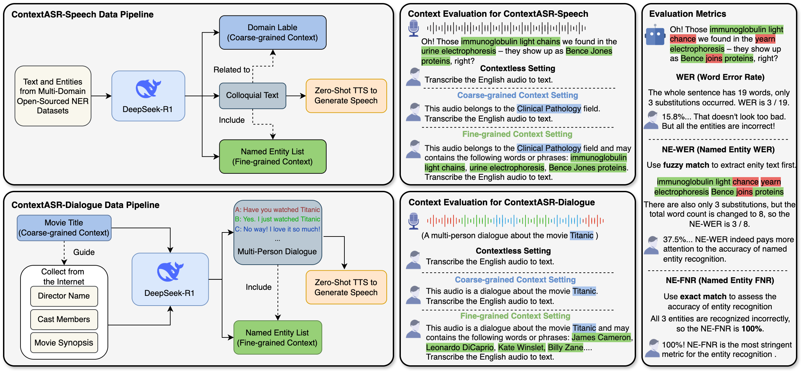

# ContextASR-Bench: A Massive Contextual Speech Recognition Benchmark  
<p align="center" dir="auto">
<a href="https://arxiv.org/abs/2507.05727" rel="nofollow"></a>
<a href="https://huggingface.co/datasets/MrSupW/ContextASR-Bench" rel="nofollow"></a>
</p>
Automatic Speech Recognition (ASR) has been extensively investigated, yet prior benchmarks have largely focused on assessing the acoustic robustness of ASR models, leaving evaluations of their linguistic capabilities relatively underexplored. This largely stems from the limited parameter sizes and training corpora of conventional ASR models, leaving them with insufficient world knowledge, which is crucial for accurately recognizing named entities across diverse domains. For instance, drug and treatment names in medicine or specialized technical terms in engineering. Recent breakthroughs in Large Language Models (LLMs) and corresponding Large Audio Language Models (LALMs) have markedly enhanced the visibility of advanced context modeling and general artificial intelligence capabilities. Leveraging LLMs, we envision a unified system capable of robust speech recognition across diverse real-world domains, yet existing benchmarks are inadequate for evaluating this objective. To address this gap, we propose ContextASR-Bench: a comprehensive, large-scale benchmark designed to assess the linguistic competence of ASR systems using corpora that feature numerous named entities across multiple domains. It encompasses up to 40,000 data entries with more than 300,000 named entities across over 10 domains. Beyond the audio and its transcription, each sample provides the domain it belongs to and a list of named entities it contains, which are referred to as the context. Based on this, we introduce three evaluation modes to assess how effectively models can exploit such context to improve ASR accuracy. Extensive evaluation on ContextASR-Bench highlights that LALMs outperform conventional ASR models by a large margin thanks to the strong world knowledge and context modeling of LLMs, yet there remains ample room for further improvement. 

## 🖥️ Overview of ContextASR-Bench
The below figure is an overview of our proposed ContextASR-Bench, comprising ContextASR-Speech and ContextASR-Dialogue, two distinct test sets. The left part shows the data pipeline for these two test sets. Both use DeepSeek-R1 to generate entity-rich corpora, which are then synthesized into speech using Zero-Shot TTS. Each entry in both sets follows the same data structure: &lt;**Audio**, **Text**, **Coarse-grained Context**, **Fine-grained Context**&gt;. The middle part presents three contextual evaluation settings. The contextless setting can be used for evaluating any ASR systems, while the other two assess LALMs' context comprehension capacity through different granularity information within the prompt. The right part introduces three evaluation metrics used in ContextASR-Bench. **NE-WER** and **NE-FNR** focus more on the accuracy of entity recognition compared to **WER**.  
<!--    -->
<div style="text-align: center;">
  <br/>
</div>

## 🗂️ Download ContextASR-Bench Data  
The ContextASR-Bench dataset is now available for download at [🤗Huggingface🤗](https://huggingface.co/datasets/MrSupW/ContextASR-Bench). 


## 📑 Evaluation Code  
The example evaluation code is provided in the `evaluation` folder.  
You can check the [`evaluation/README.md`](evaluation/README.md) file for more details.

## 📚 Citation
```
@article{wang2025asrbench,
      title={ContextASR-Bench: A Massive Contextual Speech Recognition Benchmark}, 
      author={He Wang and Linhan Ma and Dake Guo and Xiong Wang and Lei Xie and Jin Xu and Junyang Lin},
      year={2025},
      eprint={2507.05727},
      archivePrefix={arXiv},
      primaryClass={eess.AS},
      url={https://arxiv.org/abs/2507.05727}, 
}
```
